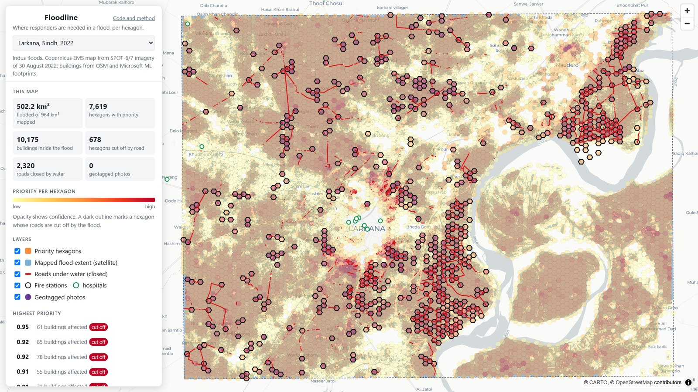
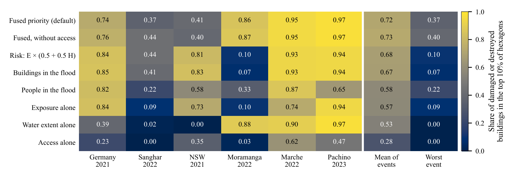
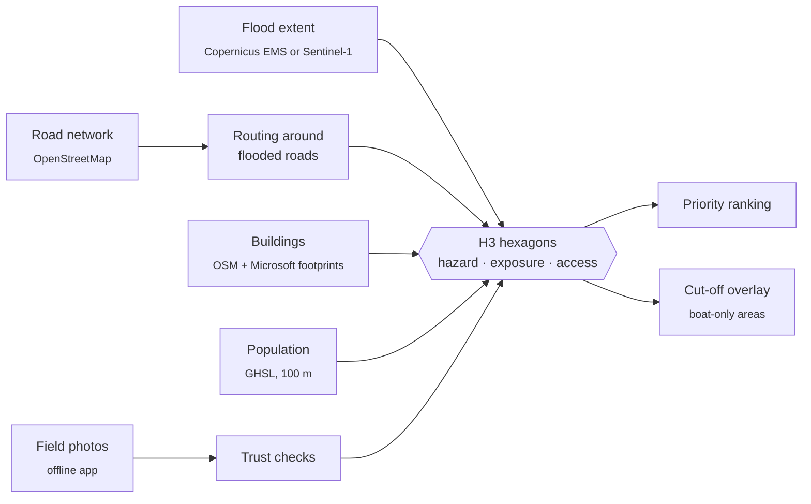
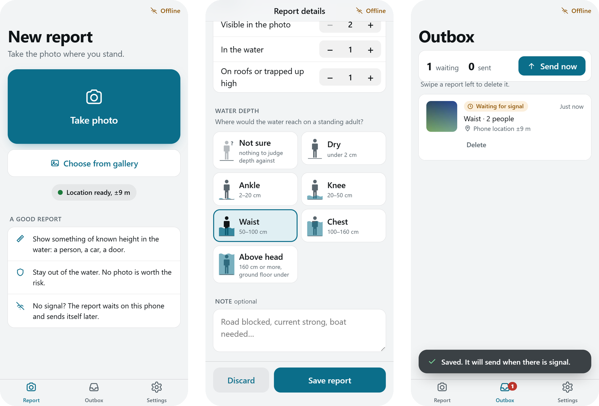

<div align="center">

# Floodline

**Where should flood responders go first?**

A ranked map of flooded neighbourhoods, built from free data in a day,<br>
and tested against the damage that actually happened in six real floods.

[](https://github.com/sunnyallana/floodline/actions/workflows/ci.yml)
[](LICENSE)

[](https://floodline.sunnyshabanali.dev/map/)
[](https://huggingface.co/datasets/sunnyallana/flood-depth-benchmark)

[Project page](https://floodline.sunnyshabanali.dev) ·
[Map](https://floodline.sunnyshabanali.dev/map/) ·
[Field app](https://floodline.sunnyshabanali.dev/field/) ·
[Paper](paper/floodline.pdf) ·
[Reviewer questions](REVIEWER_QUESTIONS.md)

</div>

<br>

<a href="https://floodline.sunnyshabanali.dev/map/"></a>

<p align="center"><sub>Larkana, Sindh, 30 August 2022. 2,320 roads closed by water, 678 hexagons cut off, 10,175 buildings inside the flood.</sub></p>

## What it does

When a district floods, the coordinator at a rescue service has a few boats, a few trucks and far more calls than
either. Floodline cuts the flooded area into hexagons of about 0.1 km² and ranks them, so the first boats go where
the most people and buildings are under water, and the trucks know which neighbourhoods they can no longer reach.

Each hexagon is scored from three layers, all available within a day of a flood:

- **Hazard**: how much of it the satellite flood map shows under water.
- **Exposure**: buildings and people inside the water, plus everything in a hexagon the flood cuts off.
- **Access**: how much longer the drive from the nearest fire station or hospital becomes once flooded roads are
  removed, or whether any road still gets there at all.

Photos from responders in the field are added through an offline phone app, but a photo alone never moves a boat.

## Does it work?

Copernicus analysts graded damage building by building after six floods. Floodline never sees those grades. The
test asks one question: of each town's damaged or destroyed buildings, how many sit in the 10 % of hexagons
Floodline ranked highest? A random ranking scores 0.10.

| | Result |
|---|---|
| Damage found in the top 10 % of hexagons | **0.76** (95 % block-bootstrap interval 0.55 to 0.78) over 11 towns and 3,806 buildings |
| Worst single flood | **0.37**. Every building, water, exposure or access layer alone falls to 0.10 or below on some flood |
| Floods the weights never saw | **0.72** for the fixed weights, against 0.59 for weights fitted to the other five floods |
| Road-closure rule against analysts' road grades | precision **0.77**, recall **0.77** across all six floods |



The average hides the point. Counting buildings in the water scores as well as the fused priority overall, then
finds almost nothing in Moramanga, Madagascar (0.07). Water extent alone finds nothing in New South Wales. A
coordinator does not know in advance which kind of flood they face, so the score that never collapses is the one
to use. Full tables: [`results/README.md`](results/README.md), section 8.

## How it works



```
priority = 0.45 × exposure + 0.30 × hazard + 0.25 × access      (only in hexagons that are wet or cut off)
```

Roads count as closed once 5 m of them lie under water, a threshold chosen on the German floods and still the best
when scored across all six. Responders start from fire stations and hospitals that are not themselves flooded; where none
lies inside the downloaded road network, they enter at its edge and the gap is costed at 30 km/h.

## Fake reports

Anyone can download the app, so the system assumes some reports will be wrong or malicious.

- **One invite per phone.** A coordinator issues single-use codes (`floodline invites`). Each phone redeems one
  and receives its own identity, signed by the server. The public key in the app can write nothing on its own, so
  posing as ten phones takes ten invites, each labelled with the person it was given to.
- **Known photos are caught.** Every photo is hashed and compared with 11,563 published flood photos and all
  earlier reports. 99.8 % of forwarded copies are caught.
- **A report alone cannot raise priority.** A depth or people claim counts only when satellite water nearby or,
  where the satellite has not looked, a second phone backs it. Everything else goes to a verification list.
- **Withdrawal is retroactive.** `floodline devices --revoke` stops a phone at once, and its past reports drop
  out on the next ingest.

| Simulated attack on the Prague map | Top 10 unchanged, first rule | Top 10 unchanged, now | Fakes flagged |
|---|---|---|---|
| 50 fake reports in dry areas | 1.00 | 1.00 | 50 / 50 |
| 10 pairs of colluding phones in dry areas | 0.30 | 1.00 | 10 / 10 |
| 50 exaggerated reports inside real water | 0.39 | 0.91 | 50 / 50 |

The full list of threats, and the gaps still open, is in [`THREAT_MODEL.md`](THREAT_MODEL.md).

## Field app



A web app responders install from the browser. It takes a photo with location and time, asks how many people are
in the water or trapped up high and how deep the water is, and keeps the report on the phone until there is
signal. The location is taken from the photo's own GPS first, and from the phone only if the photo is under ten
minutes old, so a gallery picture never inherits where the phone is now.

TypeScript, a service worker, IndexedDB, and Supabase PostgreSQL with row-level security. 62 unit and database
policy tests and 4 end-to-end tests run in CI. Source in [`app/`](app) and [`supabase/`](supabase).

## What did not work

Reported in full, because a reviewer should not have to find these alone.

| Idea | Result |
|---|---|
| Sentinel-1 radar in place of the analysts' map | Capture falls to 0.21 (change detection) or 0.27 (threshold). Fine on open floodplains, not yet inside towns |
| OpenStreetMap buildings only | 0.74 pooled, but New South Wales drops from 0.41 to 0.19 and Sanghar from 0.37 to 0.23 |
| Fitting the weights to the data | 0.59 on held-out floods against 0.72 for the fixed weights |
| Water depth from geometry in the photo | 40 % exact against 38 % for always answering "ankle" |
| Water depth from a vision-language model (Qwen3-VL-8B) | 30 % exact against 35 % for the same baseline. It no longer counts as evidence |

## Quick start

```bash
git clone https://github.com/sunnyallana/floodline && cd floodline
pip install -e ".[geo,dev]"
pytest                                   # 190 tests, no downloads
```

Rank a town from a Copernicus EMS package:

```bash
EMS=data/external/ems/EMSR045/EMSR045_06PRAHA_DELINEATION_DETAIL01_v2_vector
floodline satellite $EMS --resolution 9 --out satellite_prague.csv
floodline reach    results/satellite_prague.csv --ems $EMS --out reach_prague
floodline exposure results/satellite_prague.csv --ems $EMS --reach results/reach_prague.csv --out exposure_prague.csv
floodline fuse     results/satellite_prague.csv results/reach_prague.csv results/exposure_prague.csv --out hexes_prague
floodline serve    results/hexes_prague.csv --key prague --title "Prague, June 2013" --ems $EMS
```

Re-run the six-flood benchmark (OSM extracts and their checksums are listed in [`data/README.md`](data/README.md)):

```bash
floodline benchmark EMSR517 data/external/ems/EMSR517_GRA --osm-pbf <extracts>
floodline benchmark summary --bootstrap 1000
floodline site                           # rebuilds the project page from the result files
```

Field reports, on the analysis machine (`SUPABASE_URL` and `SUPABASE_SERVICE_KEY` in the environment):

```bash
floodline invites <team code> --count 10 --label "Rescue 1122 Larkana"
floodline ingest --prune-orphans
```

## Reproducibility

Every stage writes a run record next to its result: the git commit, parameters, timing and host. The paper and the
project page never hard-code a number; both are generated from the files in [`results/`](results), so a rerun
updates them. Dependencies are locked in [`requirements/`](requirements), OSM extracts are pinned by checksum, a
Docker image builds in CI, and long stages resume where they stopped.

## Repository

```
src/floodline/   the pipeline: one module per stage, a single `floodline` command
tests/           190 tests, run in CI on Python 3.11 and 3.12
results/         every number quoted anywhere, with its run record
paper/           the IEEE paper; numbers.tex and the figures are generated from results/
app/             Floodline Field, the offline phone app
supabase/        database schema and row-level security for field reports
docs/            the published site: project page, map, field app, label review tool
```

## Future work

- [ ] Blind human review of the 300 depth labels (the tool is live at [`/review/`](https://floodline.sunnyshabanali.dev/review/))
- [ ] Review by rescue and disaster-management staff ([`paper/practitioner_review.md`](paper/practitioner_review.md))
- [ ] A DOI for the depth dataset and an archived release of the benchmark
- [ ] Radar flood mapping that works inside towns, not only on open floodplains
- [ ] Benchmark the photo model's people counts, as was done for depth
- [ ] A coordinator screen for the verification list, which is a CSV column today
- [ ] Background upload while the app is closed, and province-scale maps as vector tiles
- [ ] More graded floods: EMS activations after EMSR653 have not been scanned yet

## Data and licences

Code is MIT. Flood maps and damage grading © European Union, Copernicus Emergency Management Service. Roads and
buildings © OpenStreetMap contributors and Microsoft Global ML Building Footprints, both ODbL. Population: GHSL,
European Commission JRC, CC BY 4.0. Radar: modified Copernicus Sentinel data via the Microsoft Planetary Computer.

## Citation

```bibtex
@software{shabanali2026floodline,
  author = {Shaban Ali, Sunny},
  title  = {Floodline: ranking where flood responders are needed from satellite flood extent,
            road access, building exposure and field reports},
  year   = {2026},
  url    = {https://github.com/sunnyallana/floodline}
}
```

<p align="center"><sub>Built by <a href="https://sunnyshabanali.dev">Sunny Shaban Ali</a> as a final-year project at FAST-NUCES, Karachi, supervised by Musawar Ali.</sub></p>
